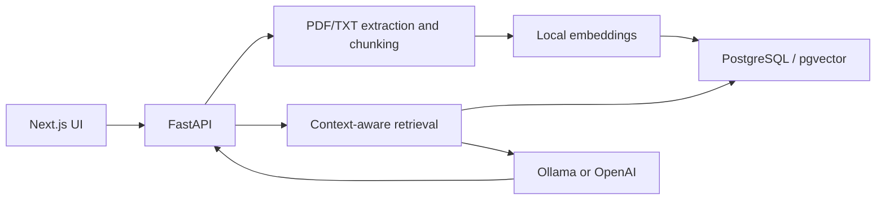

# AI Knowledge Chatbot

**Final Project 1:** an AI-powered chatbot with a custom knowledge base, Next.js frontend, and FastAPI backend. Upload PDF/TXT documents and ask questions grounded in retrieved content, with source citations and conversation memory. Local answers use Ollama with Qwen3 1.7B and require no paid API credits.

Repository: https://github.com/Nabilthahamid/ai-knowledge-chatbot

## Requirement coverage

| Requirement | Implementation / status |
| --- | --- |
| Custom knowledge base | Extract documents, create overlapping chunks, compute local embeddings, and store in PostgreSQL/pgvector. Supports up to 10 MB per file; medium-size load testing remains. |
| Answers using only the knowledge base | RAG context, knowledge-only model instructions, and citations. Accuracy needs evaluation against your documents; instructions alone cannot guarantee correctness. |
| Out-of-scope handling | Polite fallback when retrieval is empty or below the similarity threshold; model instructed to decline unsupported facts. |
| Intelligent retrieval | Semantic cosine-similarity search with top-k and recent conversation context. |
| Conversation memory | Session history; default recent-message limit is 12. |
| Multiple formats | UTF-8 TXT and text-based PDF. Web pages and scanned-PDF OCR are not implemented. |
| Updates without full retraining | Upload/index new documents and delete existing files and their chunks. |
| User/admin authentication | Not implemented; admin endpoints and session history are unprotected. |
| API documentation | Swagger UI, ReDoc, and OpenAPI schema. |
| Backend logging | Uvicorn access logs and chat-generation exception logging. |
| Complete frontend | Chat sessions, streaming, citations, and document upload/delete UI. |
| Backend and clean API architecture | FastAPI modules for chat, knowledge ingestion, retrieval, and administration; frontend API client. |
| GitHub maintenance | Source, tests, dependency lockfile, configuration examples, and setup documentation in this repository. |

Knowledge handling uses **retrieval-augmented generation (RAG)** rather than fine-tuning model weights. Embeddings use `sentence-transformers/all-MiniLM-L6-v2` (384 dimensions). Local generation uses `qwen3:1.7b`, thinking disabled, and temperature zero.

## Architecture



## Prerequisites

- Python 3.11 (tested with 3.11.9)
- Node.js 22 and npm (tested with 22.14.0)
- Docker Desktop with Linux containers running
- [Ollama for Windows](https://ollama.com/download/windows)
- Internet for initial dependency and model downloads

The tested machine has approximately 16 GB RAM and an RTX 3060. The portable runtime used for verification ran on CPU. Model binaries, private uploads, environment files, and installed dependencies are excluded from Git.

## Setup on Windows

### 1. Clone and start PostgreSQL

```powershell
git clone https://github.com/Nabilthahamid/ai-knowledge-chatbot.git
cd ai-knowledge-chatbot
docker compose -f infra/docker-compose.yml up -d --wait
```

PostgreSQL/pgvector runs on port 5432 with local development credentials from the compose file. A named volume preserves database data.

### 2. Download and run the local model

Install Ollama, open a new terminal, then run:

```powershell
ollama pull qwen3:1.7b
```

Ollama normally runs in the background. If stopped, run `ollama serve` in a separate terminal. Its endpoint is http://127.0.0.1:11434.

The original workspace can instead run `.\infra\start-local-llm.ps1` with its portable runtime. Portable binaries and models are not uploaded; a new clone should install Ollama normally.

### 3. Start the backend

In a separate terminal from the repository root:

```powershell
cd backend
python -m venv .venv
.\.venv\Scripts\python.exe -m pip install -r requirements.txt
Copy-Item .env.example .env
.\.venv\Scripts\python.exe -m uvicorn app.main:app --host 127.0.0.1 --port 8000
```

Run from `backend` so uploads use the expected directory. The local embedding model downloads on first use.

### 4. Start the frontend

In another terminal from the repository root:

```powershell
cd frontend
npm ci
Copy-Item .env.example .env.local
npm run dev
```

| Page / endpoint | URL |
| --- | --- |
| Chat | http://localhost:3000 |
| Document administration | http://localhost:3000/admin |
| Swagger docs | http://127.0.0.1:8000/docs |
| ReDoc | http://127.0.0.1:8000/redoc |
| OpenAPI schema | http://127.0.0.1:8000/openapi.json |
| Health | http://127.0.0.1:8000/health |

After initial downloads, local answers require no OpenAI key or credits. Keep PostgreSQL, Ollama, the backend, and the frontend running.

## Configuration

Copy the supplied `.env.example` files. Never commit real credentials.

| Backend variable | Default / purpose |
| --- | --- |
| `LLM_PROVIDER` | `ollama`; optional alternative: `openai` |
| `OLLAMA_BASE_URL` | `http://127.0.0.1:11434` |
| `OLLAMA_MODEL` | `qwen3:1.7b` |
| `DATABASE_URL` | Local PostgreSQL URL in `.env.example` |
| `RAG_MIN_SIMILARITY` | `0.35`; tune/evaluate for your documents |
| `MEMORY_MESSAGE_LIMIT` | `12` |
| `OPENAI_API_KEY` | Required only for the OpenAI provider |
| `OPENAI_MODEL` | `gpt-5` for the optional OpenAI provider |

Frontend configuration: `NEXT_PUBLIC_API_URL=http://127.0.0.1:8000`. Restart the backend after changes; restart/rebuild the frontend when its environment changes.

## Demonstration

1. Upload `examples/knowledge-base.txt` through `/admin`.
2. Ask **How long is the OrionDesk warranty?** Expected: **17 months**, with a citation.
3. Ask **Which days is its support available?** Expected: **Monday through Friday**, using session context.
4. Ask **What is the CEO's name?** Expected: a polite response that the information is absent.
5. Demonstrate PDF upload and adding/deleting documents without model retraining.

Observed local output:

```text
How long is the OrionDesk warranty?
The OrionDesk warranty is exactly 17 months.

Which days is its support available?
The OrionDesk support is available Monday through Friday.
```

These streaming requests took about 5.0 and 5.8 seconds on CPU for this small example. This is not a medium-size load benchmark.

## Validation

From `backend`, with PostgreSQL running:

```powershell
.\.venv\Scripts\python.exe -m pytest tests -q
```

From `frontend`:

```powershell
npm run lint
npm run build
```

Latest local verification: **10 backend tests passed**, frontend lint/build passed, and chat/admin/health endpoints returned HTTP 200. Live checks covered ingestion, retrieval, streaming, citations, a follow-up question, and refusal of an unsupported fact. Automated AI adapter tests use mocked service responses.

## Structure

```text
backend/app/admin/       Document listing and deletion
backend/app/chat/        Sessions, messages, memory, streaming
backend/app/knowledge/   Extraction, embeddings, vector storage
backend/app/rag/         Retrieval and answer generation
backend/tests/           Backend tests
frontend/app/            Chat and admin UI
frontend/lib/api.ts      API client
infra/                   Database compose and local model startup
examples/                Fictional sample knowledge base
```

## Remaining work and submission

Evaluate accuracy and performance on a representative medium-size knowledge base before demonstration. Optional extensions include authentication, web ingestion, OCR, vector indexes for larger datasets, and broader backend logging.

The required submission PDF must include **your name, student ID, this repository link, and sample output screenshots**. The PDF/screenshots are not yet included. Verify the demonstration date with your course instructions.
